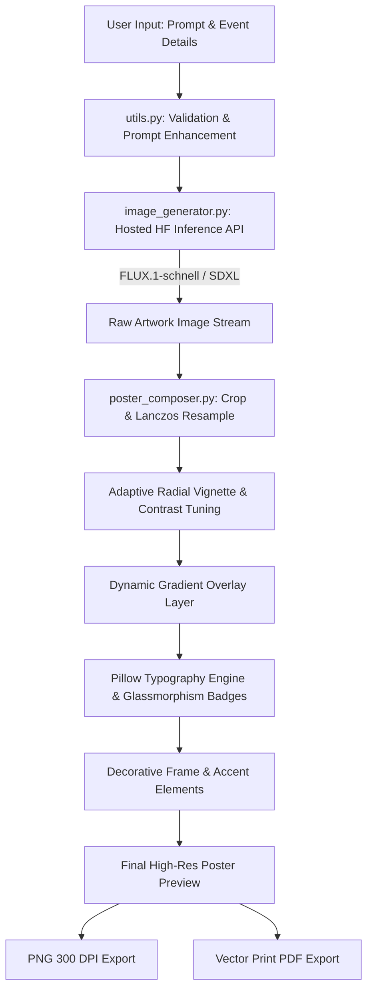

# 🎨 PromptPoster AI — AI-Powered Poster Generator

**PromptPoster AI** is an intelligent, high-fidelity poster creation web studio built with **Python** and **Streamlit**.

It works **100% locally and offline out of the box** — **NO API keys, tokens, or external accounts required!**

1. **Instant Generative Artwork:** Procedurally synthesizes high-resolution background artwork tailored to your chosen category, style, and color palette in under 1 second.
2. **Custom Upload Support:** Also allows you to upload any existing image or photo to convert into a poster.
3. **Flawless Typography:** Composes crisp, legible, and properly-spelled event typography, glassmorphism info cards, glowing badges, and graphic borders using Python Pillow.
4. **Export:** Delivers high-resolution PNG (300 DPI) and print-ready PDF downloads.


---

## 🌟 Key Features

- **🚀 Hosted AI Text-to-Image Generation:** Powered by Hugging Face models such as `black-forest-labs/FLUX.1-schnell`, `stabilityai/stable-diffusion-xl-base-1.0`, and `ByteDance/SDXL-Lightning`. No local model weights or GPU downloads required.
- **✨ Intelligent Prompt Enhancement:** Augments natural user ideas with professional artistic tokens, lighting specs, and compositional cues while preserving original creative intent.
- **🛡️ Bulletproof Typography Rendering:** Eliminates messy AI-generated gibberish text by rendering all titles, subtitles, dates, venues, and organizer badges directly with Python Pillow and Windows TrueType fonts.
- **🎭 Visual Design Studio:**
  - **7 Categories:** Technology, College Fest, Gaming, Music, Movie, Business, Awareness.
  - **7 Aesthetics:** Cyberpunk, Minimalist, Cinematic, Retro, Futuristic, Surreal, Artistic.
  - **6 Color Themes:** Neon, Warm, Cool, Pastel, Monochrome, Vibrant.
  - **3 Aspect Ratios:** Portrait (3:4), Square (1:1), Landscape (16:9).
  - **4 Graphic Frame Styles:** Modern Minimalist, Cyberpunk Brackets, Double Luxury Frame, Borderless.
  - **Layout Controls:** Bottom, Center, or Top text anchors, with adjustable overlay opacity and vignette.
- **💎 Dark Space UI:** Built with custom glassmorphism CSS, neon accents, one-click preset inspiration chips, and real-time generation progress feedback.
- **📥 High-Resolution Export:** Instant export to 300 DPI PNG and print-ready vector PDF.
- **⚡ Instant Recomposition:** Update titles, fonts, colors, or layout placements instantly on existing artwork without re-calling the AI API.

---

## 📁 Project Architecture

```
d:/poster_building/
│
├── app.py                 # Streamlit web application & modern user interface
├── image_generator.py     # Hosted Hugging Face Inference Providers API client
├── poster_composer.py     # Graphic design pipeline, typography layout & PDF/PNG export
├── utils.py               # Prompt validation, visual enhancement engine & theme presets
├── requirements.txt       # Project dependencies
├── .env.example           # Environment template for Hugging Face API keys
├── .gitignore             # Git exclusion rules for secrets, virtual environments, and caches
└── README.md              # Comprehensive project guide and documentation
```

---

## 🚀 Quickstart Guide (Windows PowerShell)

### 1. Prerequisites
- **OS:** Windows 10 or 11
- **Python:** Python 3.12 (or 3.10+)

### 2. Create and Activate Virtual Environment
Open **PowerShell** in the project directory:

```powershell
# Navigate to the project directory
cd d:\poster_building

# Create a dedicated virtual environment
python -m venv venv

# If PowerShell script execution is restricted on your machine, enable it for this process:
Set-ExecutionPolicy -Scope Process -ExecutionPolicy Bypass

# Activate the virtual environment
.\venv\Scripts\Activate.ps1
```

### 3. Install Dependencies
```powershell
pip install -r requirements.txt
```

### 4. Configure Hugging Face API Token

1. Sign up or log in to [Hugging Face](https://huggingface.co).
2. Navigate to your [Access Tokens Settings](https://huggingface.co/settings/tokens).
3. Click **Create new token**, name it `PromptPoster`, and choose role **Read** (or **Inference Providers**).
4. Copy your token (starts with `hf_...`).
5. Create a `.env` file from `.env.example`:
   ```powershell
   Copy-Item .env.example .env
   ```
6. Open `.env` and paste your token:
   ```env
   HF_TOKEN=hf_your_actual_token_here
   ```
   *(Alternatively, you can paste the token directly into the PromptPoster AI sidebar in the web app!)*

### 5. Launch the Application
```powershell
.\venv\Scripts\streamlit run app.py
```
The application will automatically launch in your browser at `http://localhost:8501`.

---

## 💡 Sample Prompts for Instant Testing

Try clicking any of the **One-Click Inspiration Chips** in the studio, or copy these prompts:

### 1. Futuristic AI Hackathon (Technology / Cyberpunk)
- **Prompt:** `Create a futuristic AI hackathon poster with neon blue lighting, a robotic face, and a cyberpunk background.`
- **Title:** `NEUROHACK 2025`
- **Subtitle:** `National AI & Robotics Hackathon`
- **Date:** `OCTOBER 28-30, 2025`
- **Venue:** `Cyber Arena & Virtual Metaverse`
- **Organizer:** `Department of AI & Data Science`
- **Highlights:** `Prizes Worth $25,000 | 48-Hour Coding Marathon`

### 2. College Cultural Festival (College Fest / Artistic)
- **Prompt:** `Design a vibrant college cultural festival poster with colorful lights, music, and energetic abstract shapes.`
- **Title:** `EUPHORIA '25`
- **Subtitle:** `Unleash The Rhythm, Ignite The Night`
- **Date:** `NOVEMBER 15-17, 2025`
- **Venue:** `Grand Open Amphitheatre, Campus North`
- **Organizer:** `Student Cultural Council`

### 3. Environmental Awareness (Awareness / Cinematic)
- **Prompt:** `Create an environmental awareness poster showing a green planet surrounded by lush forests and pure water.`
- **Title:** `EARTH PULSE`
- **Subtitle:** `Preserve Our Planet, Protect Our Tomorrow`
- **Date:** `WORLD ENVIRONMENT DAY`
- **Venue:** `Global Action Campaign`
- **Organizer:** `EcoFuture Alliance`

### 4. Sci-Fi Blockbuster Movie (Movie / Cinematic)
- **Prompt:** `Design a cinematic science-fiction movie poster featuring an astronaut exploring an alien world with twin moons.`
- **Title:** `HORIZON ZERO`
- **Subtitle:** `In The Deepest Silence, We Found The Light`
- **Date:** `IN CINEMAS DECEMBER 2025`
- **Venue:** `Worldwide in IMAX 3D`
- **Organizer:** `Nebula Pictures & Stellar Media`

---

## 🛠️ How It Works (Under The Hood)



1. **Prompt Sanitization & Enhancement (`utils.py`):**
   Validates user input, injects visual art modifiers (lighting, octane render, depth of field, color palette), and attaches universal negative prompts to suppress unintentional artifacts or watermarks.
2. **Hosted AI API Integration (`image_generator.py`):**
   Connects to Hugging Face Inference Providers via `huggingface_hub` and direct REST HTTP fallbacks. It verifies tokens, handles rate-limits (HTTP 429), model cold-starts (HTTP 503), and auth failures (HTTP 401) gracefully.
3. **Graphic Typography & Layout Engine (`poster_composer.py`):**
   Resizes the canvas to standard poster proportions (3:4, 1:1, 16:9), renders multi-stop alpha gradient overlays, and lays out typography with dynamic word-wrapping, multi-pass drop shadows, frosted glass pill containers, and geometric corner brackets.

---

## 🔧 Troubleshooting Guide

| Issue / Error | Potential Cause | Verified Resolution |
|---|---|---|
| **PowerShell script execution error** | Execution policy restriction on Windows | Run `Set-ExecutionPolicy -Scope Process -ExecutionPolicy Bypass` in your PowerShell window. |
| **HTTP 401: Unauthorized** | Invalid or missing token | Check your token at [hf.co/settings/tokens](https://huggingface.co/settings/tokens) and confirm it has `Read` scope. Paste it into the sidebar or `.env`. |
| **HTTP 429: Rate Limit** | HF serverless free-tier cooldown | Wait 30 seconds before retrying, or switch between `FLUX.1-schnell` and `Stable Diffusion XL 1.0` in the sidebar. |
| **HTTP 503: Model Loading** | Serverless cluster cold start | The application detects `estimated_time` and retries automatically. Wait 15–20 seconds. |
| **HTTP 402: Payment Required** | Selected provider is paid-tier only | Switch the **Provider** dropdown in the sidebar to `Hugging Face Free Serverless (Native)` or choose `stabilityai/stable-diffusion-xl-base-1.0`. |
| **Fonts look default** | Windows system font missing | The app automatically searches `C:/Windows/Fonts/` for Segoe UI, Impact, Arial, Consolas, Georgia, and gracefully falls back to available fonts. |

---

## 📜 License & Acknowledgements
- Built for educational and creative demonstration.
- Powered by [Hugging Face Hub](https://huggingface.co) and open-weights models.
- Developed with Python 3.12, Streamlit, and Pillow.
